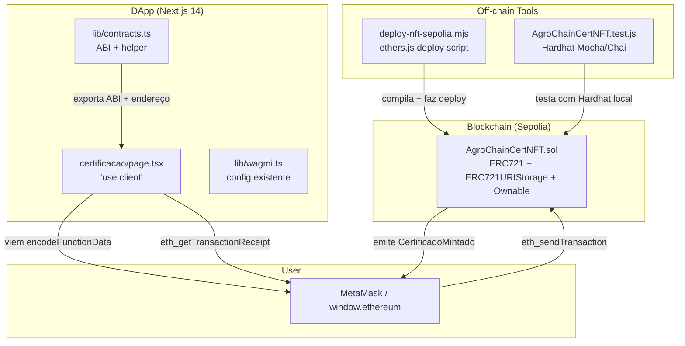
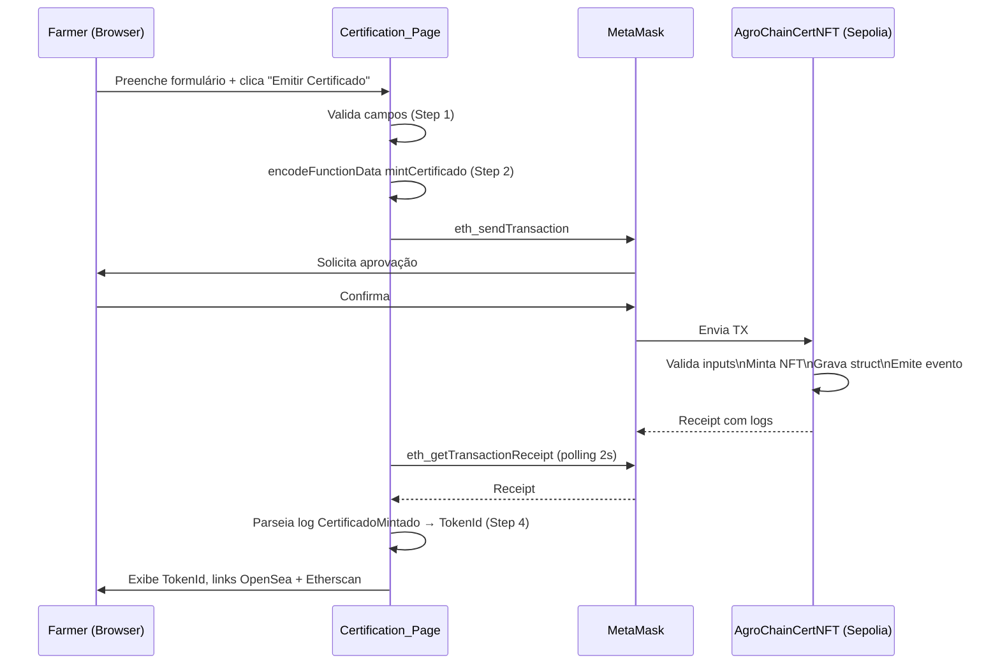

# Design Document: AgroChain NFT Certificate (ERC721)

## Overview

Este documento descreve o design técnico para a funcionalidade de certificação NFT da AgroChain. O sistema substitui o contrato `CertificacaoTest.sol` por um contrato ERC721 completo (`AgroChainCertNFT.sol`) que emite um NFT único por lote certificado. Os metadados ficam inteiramente on-chain como JSON Base64, sem IPFS. A página `/certificacao` da DApp Next.js 14 é atualizada para usar `mintCertificado`, parsear o `TokenId` do recibo e exibir links para OpenSea e Etherscan.

**Stack:**
- Solidity 0.8.37, OpenZeppelin 5.6.1
- Hardhat 3.18.1 (testes e compilação)
- ethers.js 6 (deploy script direto)
- Next.js 14, TypeScript, wagmi 2.12.29, viem 2.21.54
- Rede: Sepolia testnet (chainId 11155111)

---

## Architecture



### Fluxo de Mint (DApp → Contrato)



---

## Components and Interfaces

### 1. `AgroChainCertNFT.sol`

**Arquivo:** `blockchain/contracts/AgroChainCertNFT.sol`

```solidity
// SPDX-License-Identifier: MIT
pragma solidity 0.8.37;

import {ERC721} from "@openzeppelin/contracts/token/ERC721/ERC721.sol";
import {ERC721URIStorage} from "@openzeppelin/contracts/token/ERC721/extensions/ERC721URIStorage.sol";
import {Ownable} from "@openzeppelin/contracts/access/Ownable.sol";
import {Base64} from "@openzeppelin/contracts/utils/Base64.sol";
import {Strings} from "@openzeppelin/contracts/utils/Strings.sol";

contract AgroChainCertNFT is ERC721, ERC721URIStorage, Ownable {
    struct Certificado {
        string  batchId;
        string  tipo;
        string  variedade;
        uint256 pesoKg;
        string  origem;
        address fazendeiro;
        uint256 timestamp;
    }

    uint256 private _tokenIdCounter;
    mapping(uint256 => Certificado) public certificados;

    event CertificadoMintado(
        uint256 indexed tokenId,
        address indexed fazendeiro,
        string batchId
    );

    constructor() ERC721("AgroChain Certificado NFT", "AGCNFT") Ownable(msg.sender) {}

    function mintCertificado(
        string calldata batchId,
        string calldata tipo,
        string calldata variedade,
        uint256 pesoKg,
        string calldata origem
    ) external returns (uint256 tokenId);

    function getCertificado(uint256 tokenId)
        external view returns (Certificado memory);

    function tokenURI(uint256 tokenId)
        public view override(ERC721, ERC721URIStorage) returns (string memory);

    function supportsInterface(bytes4 interfaceId)
        public view override(ERC721, ERC721URIStorage) returns (bool);

    // Funções internas
    function _buildTokenURI(uint256 tokenId, Certificado memory cert)
        internal pure returns (string memory);
}
```

**Decisão de Design — metadados on-chain:**
Usar `Base64.encode` do OpenZeppelin sobre o JSON construído com `abi.encodePacked` evita chamadas externas e torna o NFT independente de gateways IPFS. A desvantagem é o maior custo de gas no mint (~100-150k gas extra vs. IPFS URI), aceitável para Sepolia testnet e certificados de alto valor.

**Decisão de Design — sem controle de acesso no mint:**
`mintCertificado` é público para que qualquer fazendeiro com carteira possa emitir seu próprio certificado. A imutabilidade dos dados é garantida pela própria imutabilidade do blockchain — o NFT não pode ser alterado após o mint.

**Decisão de Design — sem lock de transferência:**
Ao contrário do `AgroChainCertificacoes.sol` existente (que bloqueia transferência com `NFTIntransferivel`), o `AgroChainCertNFT` permite transferência livre. Isso melhora a compatibilidade com OpenSea e wallets. O `fazendeiro` registrado na struct permanece imutável independente de transferência.

---

### 2. `deploy-nft-sepolia.mjs`

**Arquivo:** `blockchain/scripts/deploy-nft-sepolia.mjs`

Script ESM standalone (sem Hardhat CLI) seguindo o padrão de `deploy-direct.mjs`:

```
1. Importa JsonRpcProvider, Wallet, ContractFactory de "ethers"
2. Lê artifact JSON compilado
3. Conecta em https://ethereum-sepolia-rpc.publicnode.com
4. Usa process.env.DEPLOYER_PRIVATE_KEY
5. estimateGas + 20% buffer
6. factory.deploy({ gasLimit })
7. Aguarda deploy + captura endereço
8. Grava blockchain/deployment-nft-sepolia.json
9. Imprime endereço + link Etherscan
```

---

### 3. `dapp/src/lib/contracts.ts` — adições

**Novas exportações a adicionar ao arquivo existente:**

```typescript
// ABI mínimo para mintCertificado + evento CertificadoMintado
export const AGRO_CERT_NFT_ABI = [...] as const;

// Chave usada no localStorage
export const NFT_CONTRACT_KEY = 'agrochain_nft_contract_address';

export function getNFTContractAddress(): string { ... }
export function setNFTContractAddress(address: string): void { ... }
```

---

### 4. `dapp/src/app/certificacao/page.tsx` — atualização

Substituições-chave:
- `emitirCertificado(bytes32, uint256, string)` → `mintCertificado(string, string, string, uint256, string)`
- Após recibo: parsear log `CertificadoMintado` → extrair `tokenId`
- Step 2 muda de "Gerar ZK proof" → "Preparar mint NFT"
- Seção de resultado exibe: TokenId, link OpenSea, link Etherscan

**Parsing do TokenId do log:**

```typescript
// Signature hash do evento CertificadoMintado(uint256,address,string)
const EVENT_TOPIC = '0x' + keccak256('CertificadoMintado(uint256,address,string)')

// O tokenId é o primeiro tópico indexado (topics[1])
const mintLog = receipt.logs.find(l => l.topics[0] === EVENT_TOPIC);
const tokenId = BigInt(mintLog.topics[1]).toString();
```

---

### 5. `blockchain/tests/AgroChainCertNFT.test.js`

Teste Hardhat 3.18.1 com Mocha + Chai, seguindo o padrão dos testes existentes (`import hre from "hardhat"`).

---

## Data Models

### Struct `Certificado` (on-chain)

| Campo       | Tipo    | Descrição                                        | Exemplo                      |
|-------------|---------|--------------------------------------------------|------------------------------|
| batchId     | string  | Identificador do lote                            | "COFFEE-2024-001"            |
| tipo        | string  | Tipo do produto: "Coffee" ou "Cacao"             | "Coffee"                     |
| variedade   | string  | Variedade do produto                             | "Arabica"                    |
| pesoKg      | uint256 | Peso em quilogramas                              | 500                          |
| origem      | string  | Região de origem                                 | "Minas Gerais, Brasil"       |
| fazendeiro  | address | Endereço da carteira do fazendeiro (msg.sender)  | 0xA88E04c...                 |
| timestamp   | uint256 | block.timestamp no momento do mint               | 1728823200                   |

### JSON de Metadados (off-chain, on-chain encoded)

```json
{
  "name": "AgroChain Cert #1 — COFFEE-2024-001",
  "description": "Certificado AgroChain para o lote COFFEE-2024-001 (Coffee - Arabica), 500kg, origem: Minas Gerais, Brasil",
  "attributes": [
    { "trait_type": "Batch ID",    "value": "COFFEE-2024-001" },
    { "trait_type": "Tipo",        "value": "Coffee" },
    { "trait_type": "Variedade",   "value": "Arabica" },
    { "trait_type": "Peso (kg)",   "value": "500" },
    { "trait_type": "Origem",      "value": "Minas Gerais, Brasil" },
    { "trait_type": "Fazendeiro",  "value": "0xA88E04c2D42b3BE8c77ceCAE36722D870CEe80A9" },
    { "trait_type": "Timestamp",   "value": "1728823200" }
  ]
}
```

### `deployment-nft-sepolia.json`

```json
{
  "address": "0x...",
  "chainId": 11155111,
  "deployer": "0xA88E04c2D42b3BE8c77ceCAE36722D870CEe80A9",
  "txHash": "0x...",
  "time": "2026-10-13T12:00:00.000Z"
}
```

---

## Correctness Properties

*A property is a characteristic or behavior that should hold true across all valid executions of a system — essentially, a formal statement about what the system should do. Properties serve as the bridge between human-readable specifications and machine-verifiable correctness guarantees.*

### Property 1: Round-trip de dados do certificado

*Para qualquer combinação válida de (batchId não-vazio, tipo "Coffee" ou "Cacao", variedade, pesoKg > 0, origem), após chamar `mintCertificado` com esses parâmetros, chamar `getCertificado(tokenId)` deve retornar uma struct cujos campos `batchId`, `tipo`, `variedade`, `pesoKg` e `origem` são idênticos aos valores de entrada, `fazendeiro` é igual a `msg.sender`, e `timestamp` é maior que zero.*

**Validates: Requirements 2.3, 3.2, 6.2**

---

### Property 2: Sequência monotônica de TokenIds

*Para qualquer sequência de N chamadas bem-sucedidas a `mintCertificado` (N ≥ 1), os TokenIds retornados formam uma sequência estritamente crescente [1, 2, ..., N].*

**Validates: Requirements 2.4, 3.6**

---

### Property 3: Rejeição de tipo inválido

*Para qualquer string `tipo` que não seja exatamente `"Coffee"` nem `"Cacao"` (incluindo strings vazias, com espaços extras, variações de caixa como "coffee", "COFFEE"), `mintCertificado` deve reverter.*

**Validates: Requirements 3.5**

---

### Property 4: tokenURI retorna URI Base64 válida contendo os dados do certificado

*Para qualquer certificado mintado com dados válidos, `tokenURI(tokenId)` deve retornar uma string que começa com `"data:application/json;base64,"` e, após decodificação Base64 e parse JSON, contém todos os sete campos do certificado no array `attributes`.*

**Validates: Requirements 4.1, 4.2, 4.5, 4.6**

---

### Property 5: Evento emitido com argumentos corretos

*Para qualquer chamada bem-sucedida a `mintCertificado`, o evento `CertificadoMintado` emitido deve ter `tokenId` igual ao valor retornado pela função, `fazendeiro` igual a `msg.sender` e `batchId` igual ao argumento fornecido.*

**Validates: Requirements 5.2, 5.3**

---

## Error Handling

### Contrato — Erros de Validação

| Condição                          | Revert message                              |
|-----------------------------------|---------------------------------------------|
| `pesoKg == 0`                     | `"AgroChain: pesoKg must be > 0"`           |
| `batchId` vazio                   | `"AgroChain: batchId required"`             |
| `tipo` ≠ "Coffee" ou "Cacao"      | `"AgroChain: tipo must be Coffee or Cacao"` |
| `getCertificado` com token inexistente | `"AgroChain: token does not exist"`    |
| `tokenURI` com token inexistente  | Revert padrão ERC721URIStorage              |

**Decisão:** Usar `require` com strings em vez de `custom errors` para manter compatibilidade com a decodificação de erros via `window.ethereum` na DApp sem ABI de erros customizados.

### DApp — Validação Frontend

| Condição                          | Mensagem exibida                            |
|-----------------------------------|---------------------------------------------|
| `batchId` vazio                   | "Batch ID é obrigatório"                    |
| `pesoKg` zero ou negativo         | "Peso deve ser maior que zero"              |
| `origem` vazia                    | "Origem é obrigatória"                      |
| Carteira não conectada            | "Conecte sua carteira MetaMask primeiro"    |
| Rede errada                       | "Mude para Sepolia no MetaMask"             |
| Endereço de contrato não configurado | "Configure o endereço do contrato NFT"   |
| Endereço configurado é EOA (sem bytecode) | "Endereço não é um contrato"        |
| Timeout ao aguardar recibo (> 60s) | "Timeout aguardando confirmação. Verifique no Etherscan." |
| TX rejeitada no MetaMask          | "Transação cancelada no MetaMask"           |
| Revert do contrato                | Mensagem do revert propagada                |

### Deploy Script — Erros

O script utiliza `try/catch` global com `console.error` e `process.exit(1)`. Erros comuns: saldo insuficiente de ETH, arquivo de artifact não encontrado, chave privada ausente.

---

## Testing Strategy

### Abordagem Dual

1. **Testes unitários com exemplos específicos** — verificam casos concretos, condições de erro e integrações.
2. **Testes baseados em propriedades (PBT)** — verificam propriedades universais que devem valer para qualquer input válido.

Os dois tipos são complementares: testes unitários capturam bugs concretos e documentam comportamento; testes PBT revelam edge cases que exemplos isolados não cobrem.

### Biblioteca PBT

**`fast-check`** (v3.x) — biblioteca de property-based testing para JavaScript/TypeScript. Compatível com Mocha (usado pelo Hardhat). Cada teste PBT executa mínimo **100 iterações**.

Instalação: `npm install --save-dev fast-check` na raiz do workspace.

### Testes de Propriedade (PBT)

Cada propriedade abaixo corresponde a uma das Correctness Properties do design.

**Tag format:** `Feature: agrochain-nft-cert, Property {N}: {título}`

| Teste PBT | Property | Gerador fast-check | Verificação |
|-----------|----------|--------------------|-------------|
| Round-trip de dados | Property 1 | `fc.record({ batchId: fc.string({minLength:1}), tipo: fc.constantFrom("Coffee","Cacao"), variedade: fc.string({minLength:1}), pesoKg: fc.bigInt({min:1n}), origem: fc.string({minLength:1}) })` | `getCertificado` retorna struct com todos os campos iguais |
| Sequência de TokenIds | Property 2 | `fc.integer({min:1, max:20})` (número de mints) | tokenIds = [1..N] |
| Rejeição de tipo inválido | Property 3 | `fc.string()` filtrado para excluir "Coffee" e "Cacao" | `mintCertificado` reverte |
| tokenURI Base64 válida | Property 4 | Mesmo record de Property 1 | `tokenURI` começa com prefixo correto e JSON decodificado contém todos os campos |
| Evento com args corretos | Property 5 | Mesmo record de Property 1 | Evento `CertificadoMintado` emitido com tokenId, fazendeiro, batchId corretos |

### Testes Unitários (exemplos específicos)

Cobrem casos não adequados para PBT:
- `supportsInterface` retorna true para `0x80ac58cd` (ERC721) e `0x5b5e139f` (ERC721Metadata)
- `ownerOf(tokenId)` retorna `msg.sender` após mint
- `getCertificado(999)` reverte com mensagem correta
- Múltiplos usuários (Alice, Bob) mintam e recebem tokens corretos
- `tokenURI` de token inexistente reverte

### Escopo dos Testes

| Componente | Tipo de Teste | Ferramenta |
|------------|--------------|------------|
| `AgroChainCertNFT.sol` | PBT + unitários | Hardhat + Mocha + Chai + fast-check |
| `deploy-nft-sepolia.mjs` | Nenhum (script imperativo) | Manual |
| `certificacao/page.tsx` | Nenhum automatizado | Teste manual no browser |
| Integração Sepolia | Manual (smoke) | Etherscan + OpenSea |

> Os testes de DApp não são automatizados nesta spec porque a página usa `window.ethereum` (MetaMask), que requer um ambiente de browser real. O foco dos testes automatizados é a lógica do contrato Solidity.
